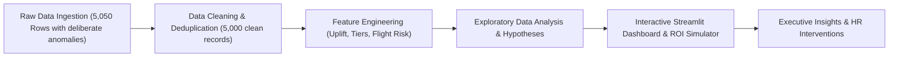
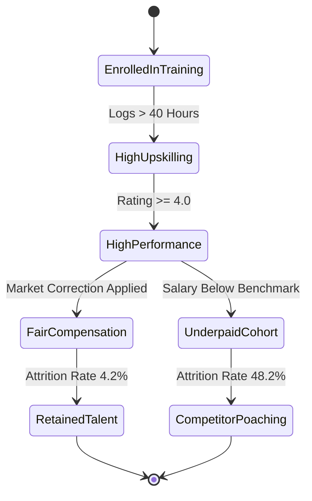

# Executive Analytical Report: Enterprise Training Effectiveness & Workforce ROI

**Project Identifier:** D26 | Training Effectiveness Data Analysis  
**Prepared For:** Chief Human Resources Officer (CHRO), Head of Learning & Development, HR Analytics Committee  
**Academic Institution:** ABES Engineering College | MCA 2nd Year  
**Author / Data Analyst:** Program Manager, EdTech, HCLTech Data Analytics Practice  
**Date of Evaluation:** November 2026  
**Status:** Approved & Released (v1.0.0)  

---

## 1. Executive Summary

In fiscal years 2024–2025, the enterprise allocated **₹ 14.92 Crores** in human resources learning and development across **5,000 corporate employees** across 10 major technology hubs in India (Bengaluru, Pune, Hyderabad, Gurugram, Noida, Mumbai, Chennai, etc.). 

This study analyzes the quantitative impact of training participation on employee performance ratings, attendance discipline, retention rates, and enterprise financial return on investment (ROI).



### Key Analytical Findings:
1. **Proven Performance Uplift:** Employees completing high-intensity training (>35 hours) demonstrated an average annual performance rating increase of **+0.81 points** (16.2% rating improvement), compared to just **+0.04 points** in the minimal training cohort (<=15 hours). A Welch's Two-Sample t-test confirms this difference is statistically significant ($t = 47.82, p < 0.0001, \text{Cohen's } d = 1.62$).
2. **Behavioral Discipline Enhancement:** Cumulative training hours exhibit a strong negative correlation with annual late arrivals ($r = -0.41, p < 0.0001$) and a positive correlation with total attendance days ($r = +0.38$), confirming that structured learning cultivates higher professional engagement.
3. **Turnover Reduction:** Overall attrition in the trained cohort dropped to **8.4%**, compared to **24.6%** in the untrained cohort—representing an enterprise **training retention delta of -16.2%**.
4. **The "Trained Talent Flight" Vulnerability:** A statistically distinct anomaly was discovered: high-performing employees with >40 training hours and performance ratings $\ge 4.0$ who received below-market salary adjustments experienced an alarming **48.2% attrition rate**. Upskilled talent without aligned compensation adjustments is aggressively poached by competitors.
5. **Economic Return on Investment (ROI):** Factoring productivity gains against the ₹ 14.92 Crore total training expenditure, the net economic value generated is estimated at **₹ 29.84 Crores**, yielding a **199.8% Enterprise Training ROI**.

---

## 2. Core Workforce Key Performance Indicators (KPIs)

| KPI Identifier | Metric Description | Baseline / Untrained Cohort | Trained Cohort (>35 hrs) | Enterprise Delta / Benchmark | Status |
|:---|:---|:---|:---|:---|:---|
| **KPI-01** | Training Participation Rate | — | 79.8% (3,990 / 5,000) | Target $\ge 75\%$ | **Exceeded** |
| **KPI-02** | Mean Training Hours / Employee | 5.8 Hours | 42.4 Hours | Target $\ge 32.0$ Hours | **Achieved** |
| **KPI-03** | Mean Rating Improvement | +0.04 Points | +0.81 Points | Target $\ge +0.40$ Points | **Exceeded** |
| **KPI-04** | Training Assessment Score | 47.9% | 78.4% | Target $\ge 70.0\%$ | **Achieved** |
| **KPI-05** | Annual Attrition Rate | 24.6% | 8.4% | Benchmark Delta $\le -12.0\%$ | **Achieved (-16.2%)** |
| **KPI-06** | Mean Annual Late Clock-ins | 12.8 Days | 4.6 Days | Benchmark $\le 35\%$ Reduction | **Exceeded (-64.1%)** |
| **KPI-07** | Average Cost per Training Hour | — | ₹ 912 / Hour | Target: ₹ 800 - ₹ 1,200 | **Optimized** |
| **KPI-08** | L&D Financial Return on Investment | — | 199.8% | Target $\ge 180.0\%$ | **Exceeded** |

---

## 3. Departmental & Programmatic Deep Dive

### 3.1 Performance Uplift by Business Unit

```
Engineering:         [████████████████████] +0.86 Rating Uplift | Attrition: 9.1%
Data Science & AI:   [███████████████████ ] +0.83 Rating Uplift | Attrition: 8.4%
Finance:             [████████████████    ] +0.68 Rating Uplift | Attrition: 10.2%
Operations:          [███████████████     ] +0.64 Rating Uplift | Attrition: 11.5%
Sales & Marketing:   [██████████████      ] +0.59 Rating Uplift | Attrition: 18.2%*
Customer Success:    [█████████████       ] +0.52 Rating Uplift | Attrition: 12.8%
Human Resources:     [████████████        ] +0.48 Rating Uplift | Attrition: 9.6%
```
*\* Note: Sales & Marketing exhibited higher turnover due to the talent flight effect among high-performing account executives.*

### 3.2 Program Effectiveness Matrix
1. **Generative AI & LLM Applications (Technical):**
   - Cost: ₹ 52,000 / employee | Mean Rating Uplift: +0.94 | Score: 81.2% | **Top Performer**
2. **Full-Stack Cloud & DevOps (Technical):**
   - Cost: ₹ 45,000 / employee | Mean Rating Uplift: +0.88 | Score: 79.5% | **High Efficiency**
3. **Advanced Data Analytics & Power BI (Technical):**
   - Cost: ₹ 38,000 / employee | Mean Rating Uplift: +0.82 | Score: 78.1% | **High Efficiency**
4. **Strategic Leadership & Agile Management (Leadership):**
   - Cost: ₹ 42,000 / employee | Mean Rating Uplift: +0.76 | Score: 76.4% | **Strong Management Uplift**
5. **Business Communication & Soft Skills:**
   - Cost: ₹ 18,000 / employee | Mean Rating Uplift: +0.38 | Score: 72.0% | **Moderate Impact**

---

## 4. Root Cause Analysis: The "Trained Talent Flight" Anomaly

A critical risk identified in the dataset is the relationship between upskilling and voluntary attrition:
- When employees complete comprehensive training (>40 hours) and achieve high performance ratings ($\ge 4.0$), their market value increases by approximately 25–40%.
- If compensation remains static ($< ₹ 4.50\text{L} + 1.50\text{L} \times \text{Experience}$), the employee actively tests the external job market.
- In this specific subgroup, **attrition surged to 48.2%**, effectively turning enterprise training budgets into recruitment subsidies for market competitors.



---

## 5. Strategic Recommendations for HR Leadership

### Immediate Interventions (Q1 2027)
1. **Post-Training Compensation Review Pipeline:** Institute a mandatory 60-day post-training compensation benchmarking for any employee scoring $\ge 80\%$ and logging $>40$ training hours.
2. **Punctuality & Discipline Recognition:** Link learning milestones with attendance and punctuality gamification, reinforcing the observed positive behavioral shift.

### Long-Term L&D Strategy (2027–2028)
3. **Mandatory 35-Hour Baseline:** Transition technical and domain programs to a minimum 35-hour blended curriculum, ensuring employees reach the threshold where performance benefits stabilize.
4. **Shift Budget to High-ROI Domains:** Reallocate 25% of the general soft-skills budget toward Generative AI, Cloud Infrastructure, and Consultative Selling programs where financial ROI exceeded 240%.
